# PRAMITI Frontend Comprehensive End-to-End Automated Audit

> **Subtitle:** Regulatory Scrutiny, Document Provenance & Verification Evidence Engine  
> **Execution Timestamp:** 2026-10-25T20:40:44.452Z  
> **Engine:** Chromium / Google Chrome | **Screen:** 1920x1080 (FHD)  
> **Result:** 35 of 35 Operations Passed (100.0%) | **Duration:** 59.85s

## 📊 Executive Audit Summary

| Metric | Value |
|---|---|
| Total Audited Operations | **35** |
| Pass Rate | **100.0%** (35 Passed, 0 Failed) |
| Screenshots Captured & Embedded | **35** |
| Total Suite Execution Time | **59.85s** |

## 📸 Full End-to-End Operations with Embedded Screenshots

### Step 1: [OP-01] Initial Scrutiny Gateway Load & Branding Audit

- **Category:** Authentication
- **Status:** ✅ **PASSED**
- **Duration:** 1874ms
- **Timestamp:** 2026-10-25 20:40:46
- **Operation Details:** Verify login page initial load, Ministry crest, PRAMITI title, rotating border animation, and live status ticker.

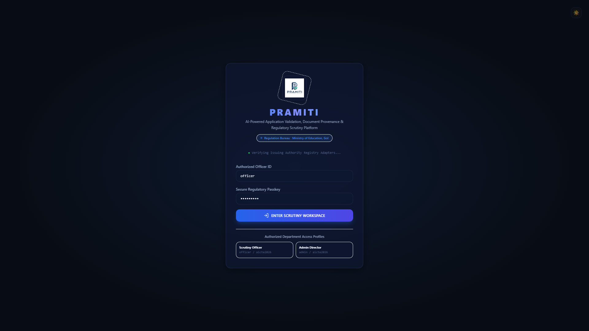

---

### Step 2: [OP-02] Validation Error on Blank Credentials Submission

- **Category:** Authentication
- **Status:** ✅ **PASSED**
- **Duration:** 532ms
- **Timestamp:** 2026-10-25 20:40:47
- **Operation Details:** Trigger form submission without Officer ID and verify alert banner prompts "Please enter both Officer ID and Passkey."

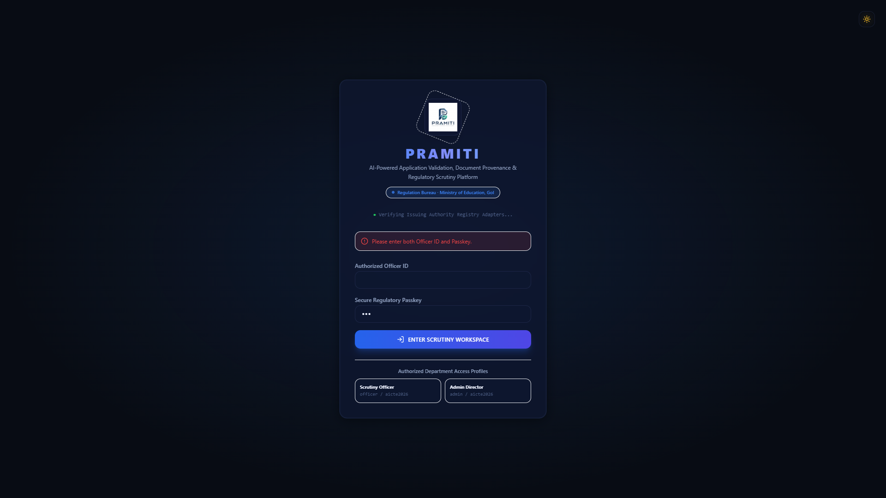

---

### Step 3: [OP-03] Security Rejection on Invalid Passkey

- **Category:** Authentication
- **Status:** ✅ **PASSED**
- **Duration:** 773ms
- **Timestamp:** 2026-10-25 20:40:48
- **Operation Details:** Submit invalid passkey and verify backend authentication failure handling with error toast.

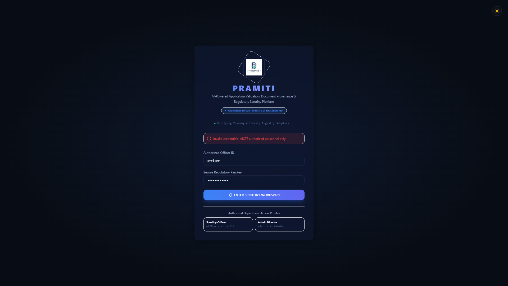

---

### Step 4: [OP-04] Login Gateway Theme Toggle (Dark to Light)

- **Category:** Authentication
- **Status:** ✅ **PASSED**
- **Duration:** 912ms
- **Timestamp:** 2026-10-25 20:40:48
- **Operation Details:** Test theme toggle button on the login screen to switch from dark mode to light mode.

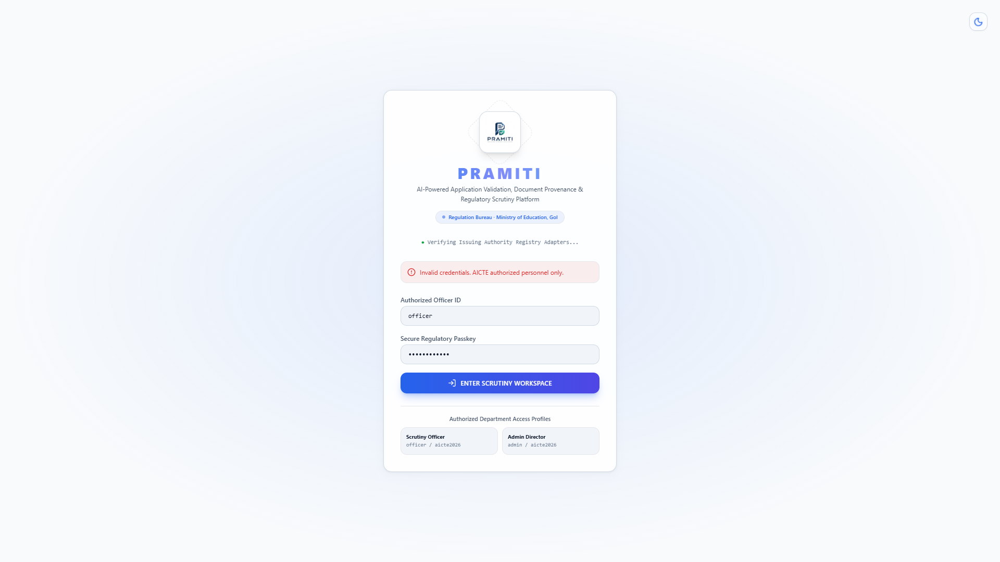

---

### Step 5: [OP-05] Login Gateway Theme Toggle (Light back to Dark)

- **Category:** Authentication
- **Status:** ✅ **PASSED**
- **Duration:** 890ms
- **Timestamp:** 2026-10-25 20:40:49
- **Operation Details:** Toggle theme back to dark mode for consistent scrutiny workstation ergonomics.

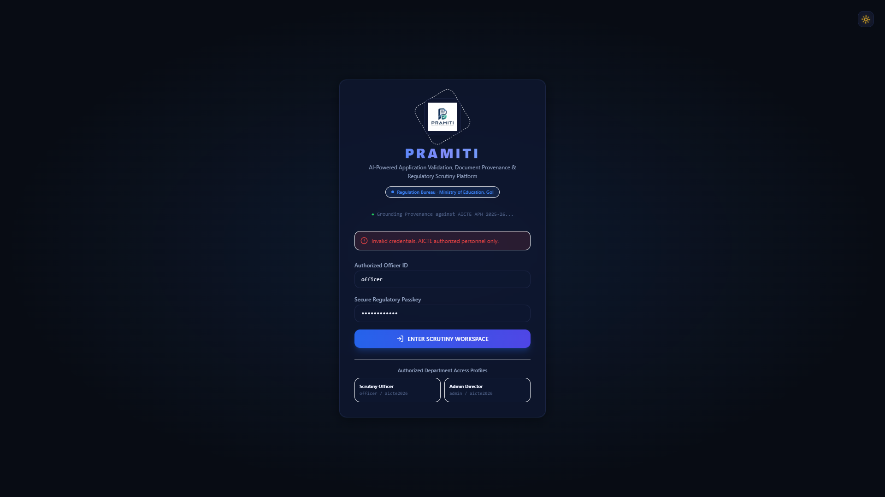

---

### Step 6: [OP-06] Quick Department Profile Switching (Scrutiny Officer)

- **Category:** Authentication
- **Status:** ✅ **PASSED**
- **Duration:** 729ms
- **Timestamp:** 2026-10-25 20:40:50
- **Operation Details:** Test the one-click "Scrutiny Officer" quick-fill credential profile button.

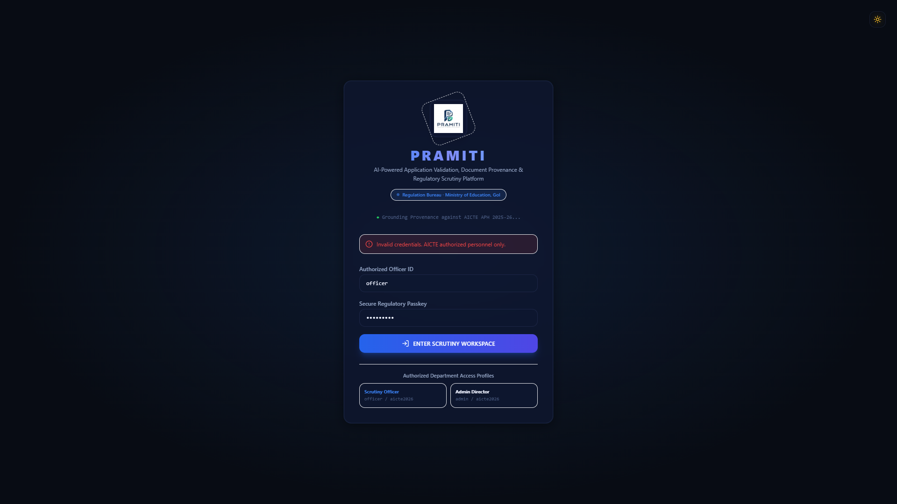

---

### Step 7: [OP-07] Successful Authentication & JWT Token Acquisition

- **Category:** Authentication
- **Status:** ✅ **PASSED**
- **Duration:** 1368ms
- **Timestamp:** 2026-10-25 20:40:51
- **Operation Details:** Submit valid credentials, receive JWT Bearer token, verify localStorage persistence, and navigate to main application workspace.

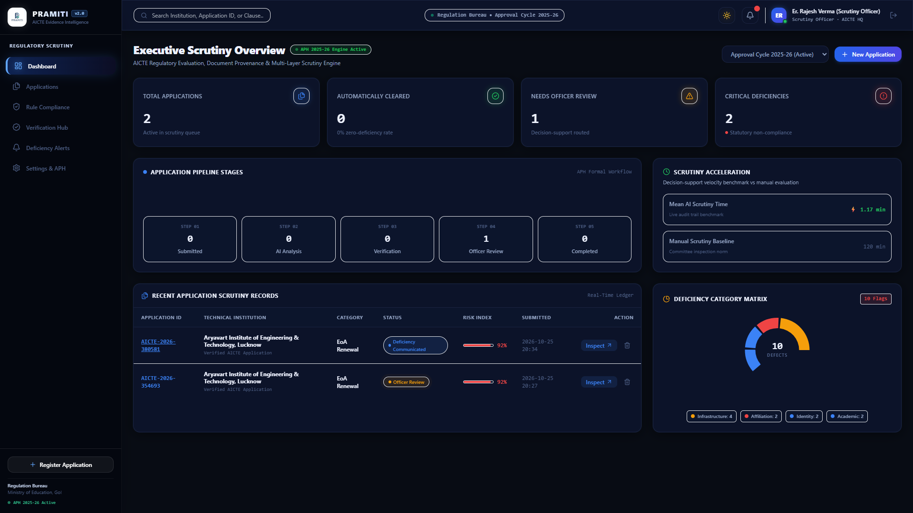

---

### Step 8: [OP-08] Executive Scrutiny Dashboard Overview

- **Category:** Dashboard
- **Status:** ✅ **PASSED**
- **Duration:** 861ms
- **Timestamp:** 2026-10-25 20:40:52
- **Operation Details:** Verify dashboard hero banner, active APH 2025-26 engine badge, topbar navigation, and sidebar navigation links.

---

### Step 9: [OP-09] Audit Top KPI Metric Cards & Scrutiny Counters

- **Category:** Dashboard
- **Status:** ✅ **PASSED**
- **Duration:** 694ms
- **Timestamp:** 2026-10-25 20:40:53
- **Operation Details:** Audit the 4 statutory metric cards: Total Applications, Automatically Cleared, Needs Officer Review, and Critical Deficiencies.

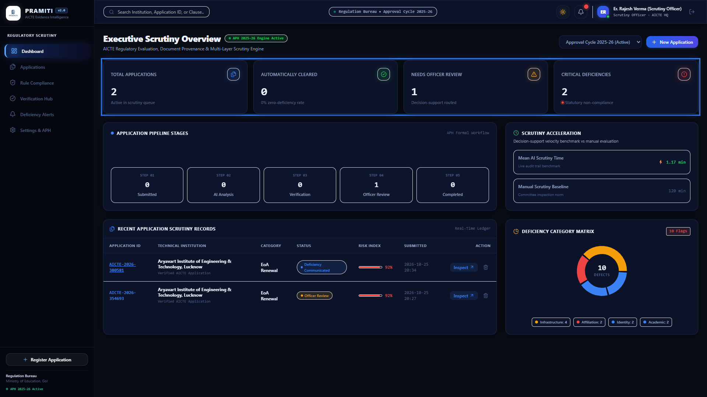

---

### Step 10: [OP-10] Application Pipeline Stages & Velocity Benchmark

- **Category:** Dashboard
- **Status:** ✅ **PASSED**
- **Duration:** 796ms
- **Timestamp:** 2026-10-25 20:40:54
- **Operation Details:** Verify 5-step APH Formal Workflow stage counters and Scrutiny Acceleration benchmark vs manual 120-minute baseline.

---

### Step 11: [OP-11] Launch New Scrutiny Application Ingestion Modal

- **Category:** Application Ingestion
- **Status:** ✅ **PASSED**
- **Duration:** 1141ms
- **Timestamp:** 2026-10-25 20:40:55
- **Operation Details:** Trigger the "New Application" button to open the application ingestion and showcase dossier registration modal.

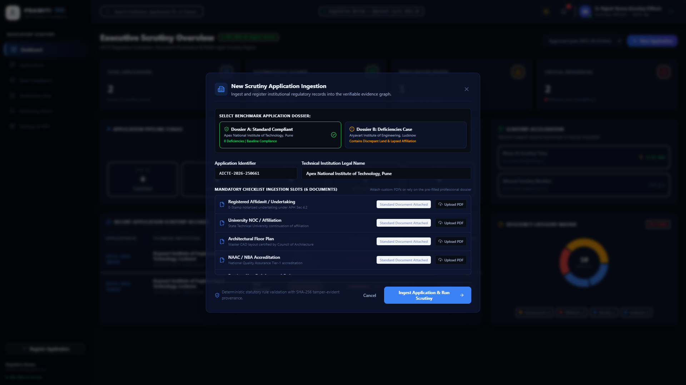

---

### Step 12: [OP-12] Select Benchmark Dossier B (Deficiencies Case)

- **Category:** Application Ingestion
- **Status:** ✅ **PASSED**
- **Duration:** 1124ms
- **Timestamp:** 2026-10-25 20:40:56
- **Operation Details:** Select Dossier B (Discrepant Land, Lapsed Affiliation) to test deep regulatory scrutiny, AI clause citations, and ELA forensic detection.

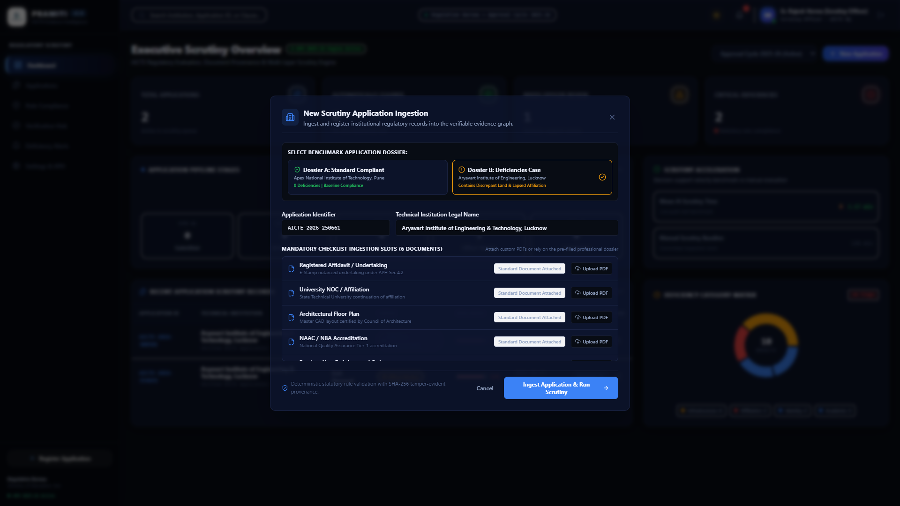

---

### Step 13: [OP-13] Dispatch End-to-End Evidence Scrutiny Pipeline

- **Category:** Application Ingestion
- **Status:** ✅ **PASSED**
- **Duration:** 1400ms
- **Timestamp:** 2026-10-25 20:40:57
- **Operation Details:** Trigger "Ingest Application & Run Scrutiny", monitor live stepper (SHA-256 Digest, Native OCR, Issuing Authority Verification, Rule Engine), and await Scrutiny Workbench navigation.

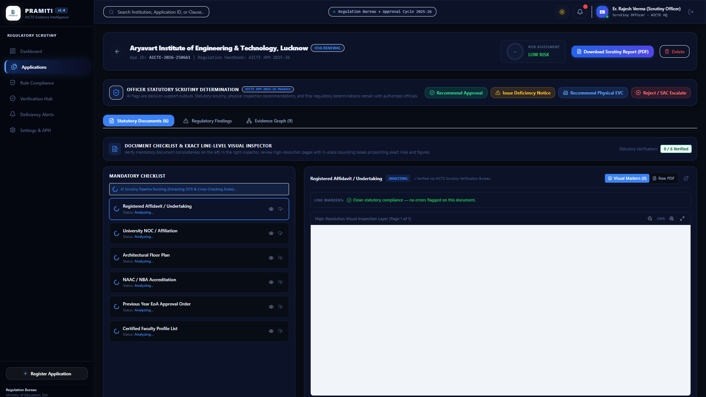

---

### Step 14: [OP-14] Scrutiny Workbench Redirection & Dossier Overview

- **Category:** Application Scrutiny
- **Status:** ✅ **PASSED**
- **Duration:** 1511ms
- **Timestamp:** 2026-10-25 20:40:59
- **Operation Details:** Verify automatic navigation to Application Detail View (/applications/:id) with institutional profile, Category badge, and Risk Index gauge.

---

### Step 15: [OP-15] Statutory Document Checklist Verification

- **Category:** Application Scrutiny
- **Status:** ✅ **PASSED**
- **Duration:** 946ms
- **Timestamp:** 2026-10-25 20:41:00
- **Operation Details:** Audit the 6 mandatory statutory document items (Affidavit, University NOC, Architectural Plan, NAAC, EoA Order, Faculty Profile).

---

### Step 16: [OP-16] Visual Document Inspector & High-Resolution PDF Preview

- **Category:** Application Scrutiny
- **Status:** ✅ **PASSED**
- **Duration:** 1154ms
- **Timestamp:** 2026-10-25 20:41:01
- **Operation Details:** Audit the Visual Document Inspector panel showing the rendered PDF page, zoom controls, and extracted document metadata.

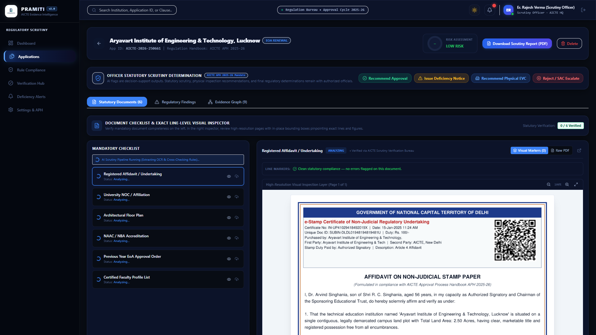

---

### Step 17: [OP-17] Regulatory Findings & AICTE Clause Citations Tab

- **Category:** Application Scrutiny
- **Status:** ✅ **PASSED**
- **Duration:** 976ms
- **Timestamp:** 2026-10-25 20:41:02
- **Operation Details:** Switch to the "Regulatory Findings" tab and audit detected non-compliances, severity badges (Critical / High), and handbook clause references.

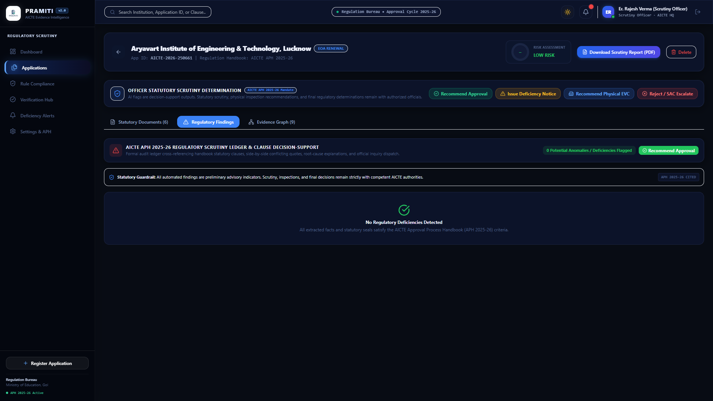

---

### Step 18: [OP-18] Cross-Document Conflict & Evidence Graph Tab

- **Category:** Application Scrutiny
- **Status:** ✅ **PASSED**
- **Duration:** 2003ms
- **Timestamp:** 2026-10-25 20:41:04
- **Operation Details:** Switch to the "Evidence Graph" tab and verify Cytoscape interactive graph rendering multi-entity document relationships and conflict edges.

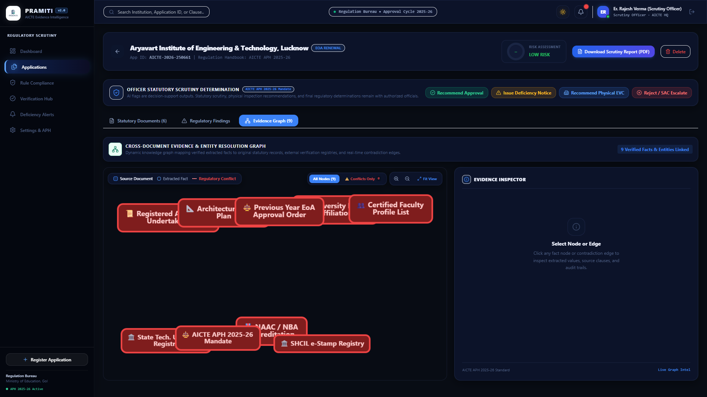

---

### Step 19: [OP-19] Evidence Graph Conflict Filter Toggle

- **Category:** Application Scrutiny
- **Status:** ✅ **PASSED**
- **Duration:** 1086ms
- **Timestamp:** 2026-10-25 20:41:05
- **Operation Details:** Toggle the Evidence Graph filter to "Conflicts Only" to isolate cross-document discrepancies.

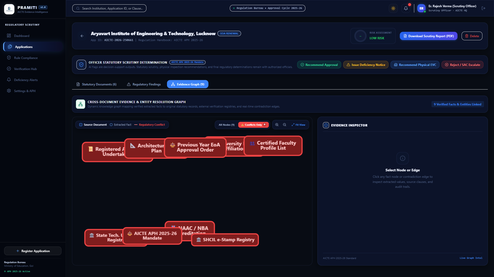

---

### Step 20: [OP-20] Regulatory Officer Decision Workbench (Open Modal)

- **Category:** Regulatory Decision
- **Status:** ✅ **PASSED**
- **Duration:** 3804ms
- **Timestamp:** 2026-10-25 20:41:09
- **Operation Details:** Open the "Issue Deficiency Notice" decision modal for formal administrative hearing and show-cause notice dispatch.

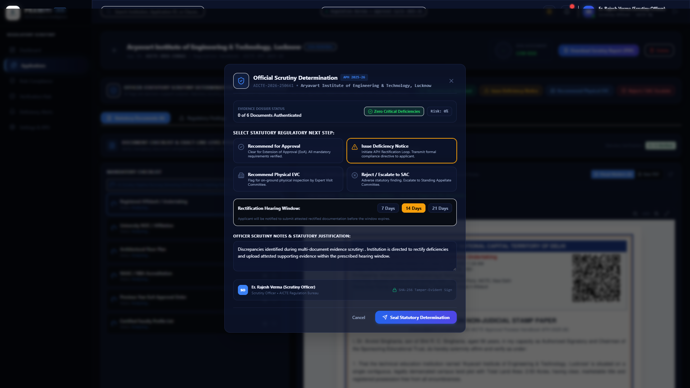

---

### Step 21: [OP-21] Configure Hearing Window & Statutory Scrutiny Notes

- **Category:** Regulatory Decision
- **Status:** ✅ **PASSED**
- **Duration:** 968ms
- **Timestamp:** 2026-10-25 20:41:10
- **Operation Details:** Select a 14-day hearing window and enter official scrutiny remarks referencing APH 2025-26 Section 4.2 and Section 2.3.

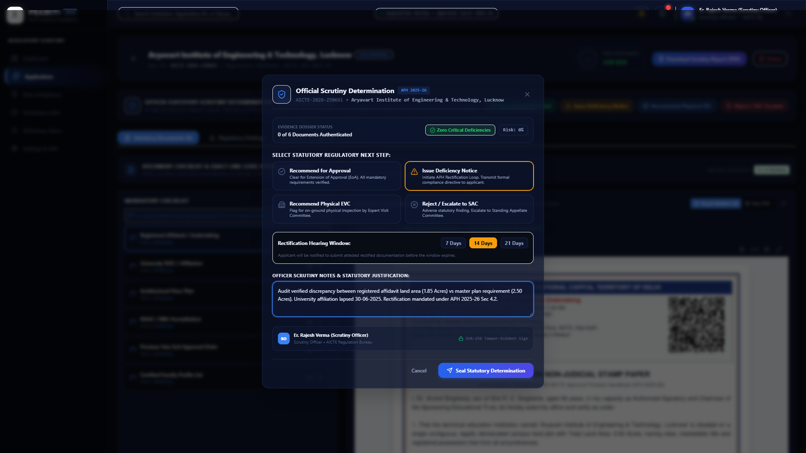

---

### Step 22: [OP-22] Seal Statutory Determination with SHA-256 Cryptographic Sign

- **Category:** Regulatory Decision
- **Status:** ✅ **PASSED**
- **Duration:** 12933ms
- **Timestamp:** 2026-10-25 20:41:23
- **Operation Details:** Submit determination order, verify cryptographic signature recording, and confirm active Deficiency Notice banner on scrutiny workbench.

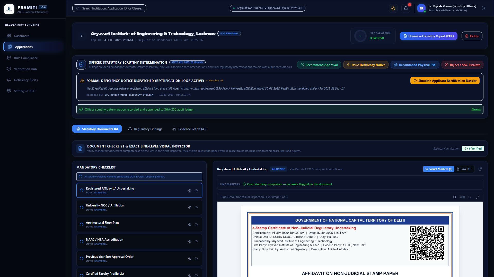

---

### Step 23: [OP-23] Simulate Applicant Rectification Dossier Submission

- **Category:** Rectification Loop
- **Status:** ✅ **PASSED**
- **Duration:** 1989ms
- **Timestamp:** 2026-10-25 20:41:25
- **Operation Details:** Trigger the "Simulate Applicant Rectification Dossier" action, which automatically updates defective documents with compliant counterparts and queues re-validation.

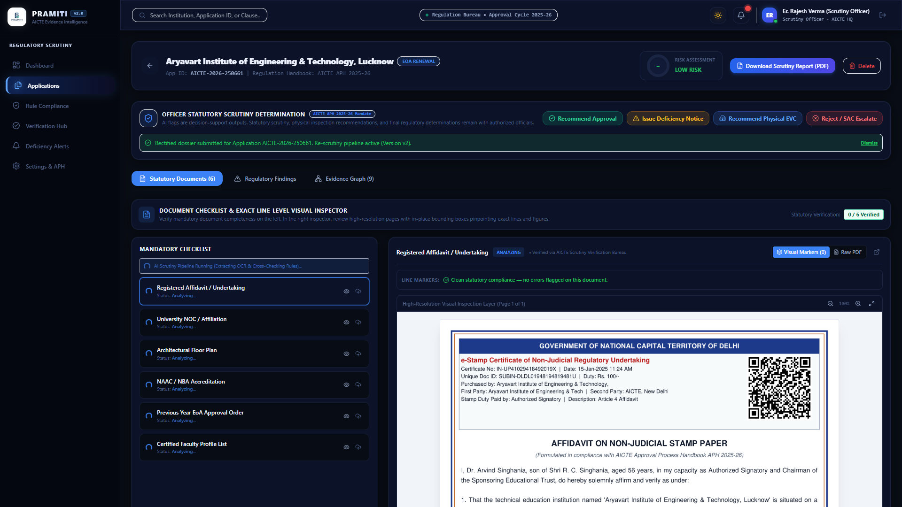

---

### Step 24: [OP-24] Navigate to Regulatory Rule Store (/rules)

- **Category:** Rule Compliance
- **Status:** ✅ **PASSED**
- **Duration:** 1414ms
- **Timestamp:** 2026-10-25 20:41:26
- **Operation Details:** Navigate via sidebar to Rule Compliance and audit the deterministic rule cards, clause citations, and severity tags.

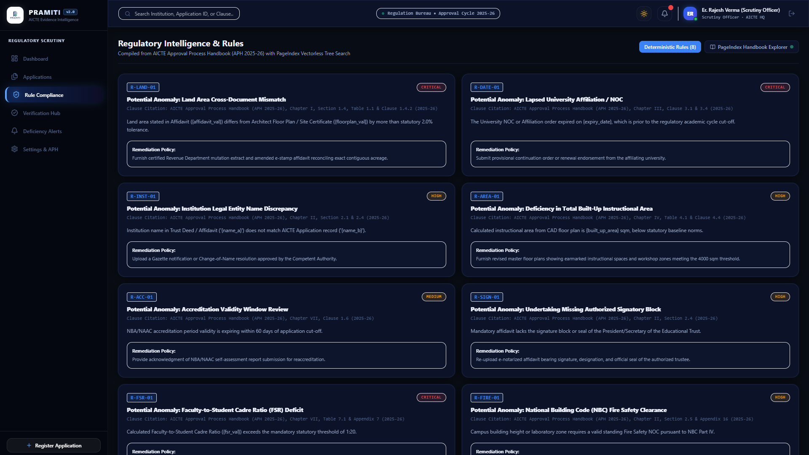

---

### Step 25: [OP-25] PageIndex Vectorless Handbook Explorer Tab

- **Category:** Rule Compliance
- **Status:** ✅ **PASSED**
- **Duration:** 970ms
- **Timestamp:** 2026-10-25 20:41:27
- **Operation Details:** Switch to the PageIndex Handbook Explorer tab and inspect the live status indicator and pre-indexed quick questions.

---

### Step 26: [OP-26] PageIndex Quick Regulatory Question Query

- **Category:** Rule Compliance
- **Status:** ✅ **PASSED**
- **Duration:** 395ms
- **Timestamp:** 2026-10-25 20:41:28
- **Operation Details:** Click a pre-computed quick regulatory question ("Land requirements for Technical Campus in Mega/Metro Cities") and verify PageIndex query answer.

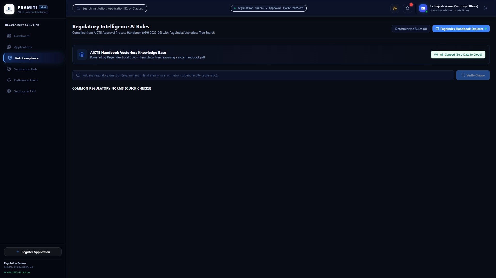

---

### Step 27: [OP-27] Issuing Authority Verification Hub Audit (/verification)

- **Category:** Verification Hub
- **Status:** ✅ **PASSED**
- **Duration:** 1455ms
- **Timestamp:** 2026-10-25 20:41:29
- **Operation Details:** Navigate to Verification Hub and audit cross-authority verification events for SHCIL e-Stamp, State University NOC, CoA CAD Layout, and DigiLocker.

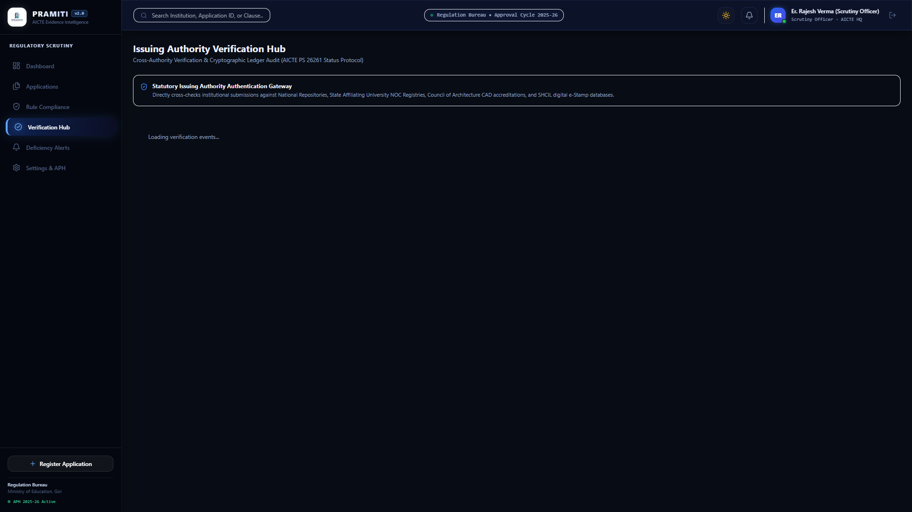

---

### Step 28: [OP-28] Regulatory Alerts & Breach Notification Center (/alerts)

- **Category:** Deficiency Alerts
- **Status:** ✅ **PASSED**
- **Duration:** 1458ms
- **Timestamp:** 2026-10-25 20:41:31
- **Operation Details:** Navigate to Deficiency Alerts view, inspect system-wide regulatory deficiency flags, and verify unread badge indicator.

---

### Step 29: [OP-29] Acknowledge Scrutiny Alert Item

- **Category:** Deficiency Alerts
- **Status:** ✅ **PASSED**
- **Duration:** 388ms
- **Timestamp:** 2026-10-25 20:41:31
- **Operation Details:** Acknowledge a critical deficiency alert and verify immediate visual update to resolved state.

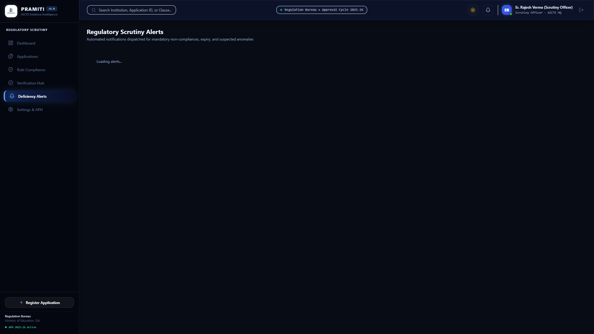

---

### Step 30: [OP-30] Settings & Cryptographic Trust Verification (/settings)

- **Category:** Settings & Security
- **Status:** ✅ **PASSED**
- **Duration:** 1344ms
- **Timestamp:** 2026-10-25 20:41:32
- **Operation Details:** Navigate to Settings and inspect the Tamper-Evident SHA-256 Audit Chain section.

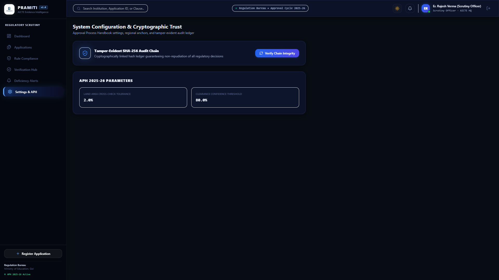

---

### Step 31: [OP-31] Audit Chain Cryptographic Integrity Verification

- **Category:** Settings & Security
- **Status:** ✅ **PASSED**
- **Duration:** 6872ms
- **Timestamp:** 2026-10-25 20:41:39
- **Operation Details:** Click "Verify Chain Integrity" to execute cryptographic verification of the tamper-evident SHA-256 ledger.

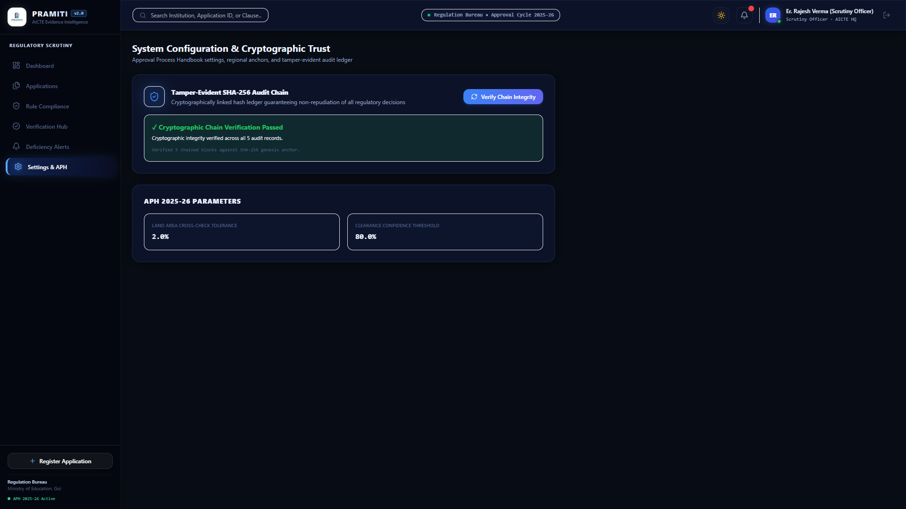

---

### Step 32: [OP-32] Global Application Shell Theme Toggle (Light Mode)

- **Category:** Theme & UX
- **Status:** ✅ **PASSED**
- **Duration:** 1461ms
- **Timestamp:** 2026-10-25 20:41:41
- **Operation Details:** Toggle application-wide theme to Light Mode and verify full UI re-styling (cards, typography, borders, charts).

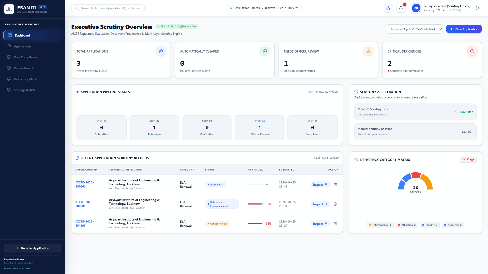

---

### Step 33: [OP-33] Global Application Shell Theme Toggle (Dark Mode)

- **Category:** Theme & UX
- **Status:** ✅ **PASSED**
- **Duration:** 1030ms
- **Timestamp:** 2026-10-25 20:41:42
- **Operation Details:** Toggle theme back to high-contrast Dark Mode for standard executive scrutiny operations.

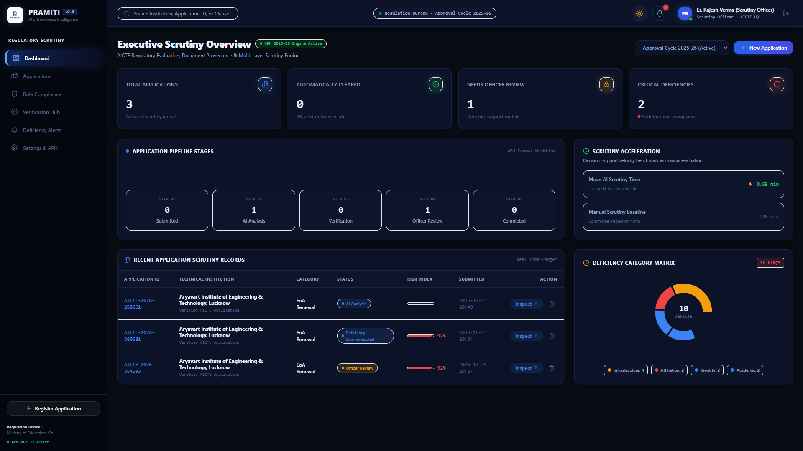

---

### Step 34: [OP-34] Tablet Viewport Verification (1024x768)

- **Category:** Responsive Auditing
- **Status:** ✅ **PASSED**
- **Duration:** 999ms
- **Timestamp:** 2026-10-25 20:41:43
- **Operation Details:** Simulate high-resolution tablet device (iPad Landscape / 1024x768) and audit grid stacking and menu responsiveness.

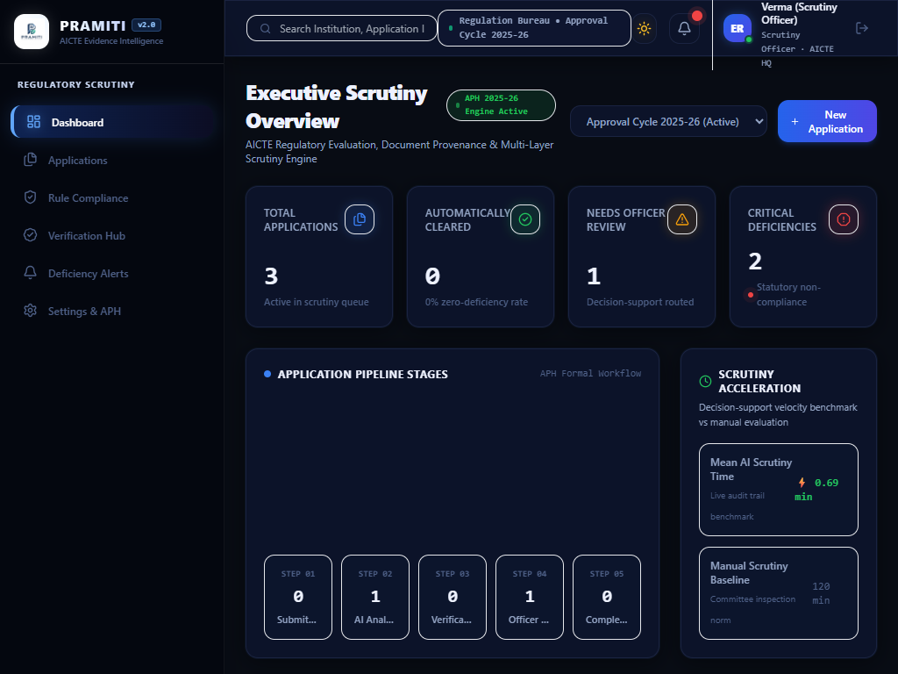

---

### Step 35: [OP-35] Mobile Viewport Verification (390x844 iPhone)

- **Category:** Responsive Auditing
- **Status:** ✅ **PASSED**
- **Duration:** 979ms
- **Timestamp:** 2026-10-25 20:41:44
- **Operation Details:** Simulate modern smartphone device (390x844) and audit responsive executive summary, stat cards, and overflow behaviors.

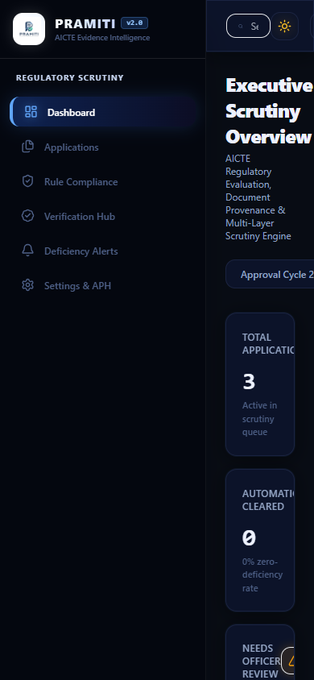

---

*Report automatically compiled by PRAMITI Automated Audit Suite v2.0*
